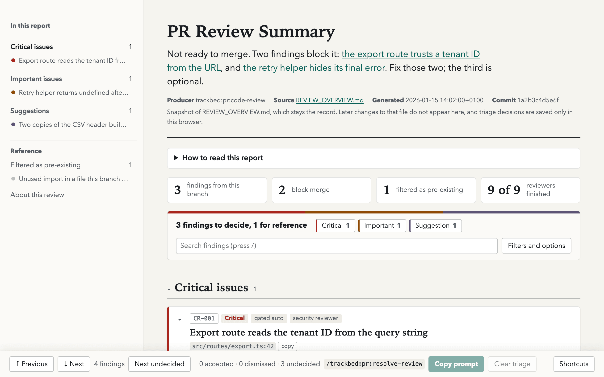

# Visual Reports

Skills that write a Markdown report or plan can also write an interactive HTML page beside it. Add `--visual` to the command:

```bash
/trackbed:pr:code-review --visual              # REVIEW_OVERVIEW.md plus REVIEW_OVERVIEW.html
/trackbed:qa http://localhost:3000 --visual    # QA_REPORT.md plus QA_REPORT.html
/trackbed:code:refactor-opportunities --visual # REFACTOR_OPPORTUNITIES_OVERVIEW.md plus its page
/trackbed:code:breakdown-findings --visual     # the PR_PLAN_*.md set plus PR_PLAN_INDEX.html
```

The skill opens the page in your browser when it can and always prints its path as `Visual report: <path>`.



## How the page is laid out

The page is built to be read, so it puts understanding before controls:

- **The verdict comes first.** The opening paragraph says what the report concluded and what to do next, and links to the entries it names. If you read nothing else, you still have the answer.
- **What you came for is on the first screen.** Reference material sits at the end in folded sections.
- **An outline stays beside the text.** It lists every section and entry, marks the one you are reading, and shows which ones you have accepted or dismissed.

Reports answer different questions, so the page takes one of five shapes:

| Shape | What you want to know | What the page leads with | What each entry holds |
| --- | --- | --- | --- |
| Findings | What is wrong, how bad is it, and what do I fix first? | Findings grouped by severity | The problem, where it is, the evidence, the suggested fix |
| Plan | What do I run first, what waits on what, and what does each step deliver? | The waves or stages side by side, then the plans in the order they run | What the plan delivers, what it depends on and unblocks, when it is done, the command to launch it |
| QA | Is it ready to ship, what was tested, and what broke? | The ship verdict and the health score, the failures worst first, then every journey with its result | What a person sees, the steps to reproduce it, expected and actual, the screenshot, the suggested fix |
| Inquiry | Which questions matter most, and what is the cheapest way to settle each? | The questions in rank order | The question, why it matters, what prompted it, how to find out, a prompt to hand to someone |
| Assessment | How does it score, where is it weakest, and what would move the score? | A scorecard, weakest first, then what is behind each score | The weakness, the evidence, the fix, and what fixing it would do for the score |

## What you can do on the page

- **Move through the entries.** Click one in the outline, use **Previous** and **Next**, or press `j` and `k`. **Next undecided** (`u`) jumps to the next one you have not triaged. Press `?` for all shortcuts; you can switch them off there.
- **Narrow it down.** Click a count beside the total to filter by it (severity on a findings page, the wave on a plan page), or search the text (press `/`). **Filters and options** holds the remaining filters, sorting, expand and collapse, the theme, and your editor. Table columns sort when you click their headings.
- **Triage and hand the result back.** Accept or dismiss each entry (`a` and `d`) and add a note; on a plan page the buttons read Run and Skip, on an inquiry Pursue and Drop. **Copy prompt** puts a message on the clipboard that names the entries you chose and the ones to leave alone; paste it to the agent to run the follow-up skill on exactly those.
- **Jump to the code.** Every location has a copy button. Choose your editor under **Filters and options** to get a link that opens the file at that line in VS Code, Cursor, Zed, Windsurf, or a custom URL.
- **Fold what you do not need.** Click a section title to fold it, or a finding's header to close it.

## What the page is not

- **Not the record.** The Markdown file stays the report that every other skill reads, such as `/trackbed:pr:resolve-review` and the breakdown skills. The page is a snapshot of it: later changes to the Markdown file do not appear on a page you already have. Rerun the skill with `--visual` for a fresh one.
- **Not shared state.** Triage decisions and notes are saved in your browser only. Nothing reaches the agent until you paste the copied prompt.
- **Not something to commit.** The page is a working artifact. `/trackbed:workflow:cleanup-artifacts` removes pages that have their skill's default name, and the commit-confirmation hook asks before a commit includes one. Delete a page you sent to a custom `--output` path yourself.

The page is a single file with no network access: it loads no remote scripts, fonts, or images, and a Content-Security-Policy in the page blocks every request.

## Which skills support it

| Shape | Skills |
| --- | --- |
| Findings | `/trackbed:pr:code-review`, `/trackbed:pr:product-review`, `/trackbed:pr:convention-review`, `/trackbed:pr:overengineering-review`, `/trackbed:code:copy-review`, `/trackbed:pr:github-review`, `/trackbed:code:refactor-opportunities`, `/trackbed:code:audit-security`, `/trackbed:product:review`, `/trackbed:docs:review`, `/trackbed:siw:spec-audit` |
| Plan | `/trackbed:code:breakdown-findings`, `/trackbed:pr:github-review-reply`, `/trackbed:code:deprecate`, the SIW spec-strengthening plan from `/trackbed:discovery:interview`, and `/trackbed:pr:github-review --stack` |
| QA | `/trackbed:qa` |
| Inquiry | `/trackbed:discovery:strategic-inquiry` |
| Assessment | `/trackbed:code:agent-readiness`, `/trackbed:code:outside-view`, `/trackbed:deps:audit`, and `/trackbed:code:refactor-opportunities --ranked` |

`--visual` needs a Markdown file to mirror, so it cannot be combined with `--inline` or with a mode that only replies in the conversation. Skills that run other skills, such as `/trackbed:linear:issue-to-pr` and `/trackbed:pr:review-convergence`, never pass it on: only the command you type gets a page.

The [decision record](decisions/2026-11-10-visual-report-style.md) explains why Markdown stays the record.
